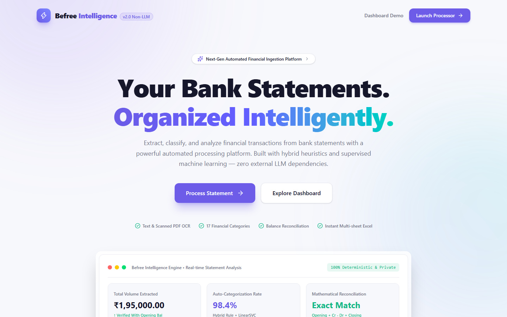
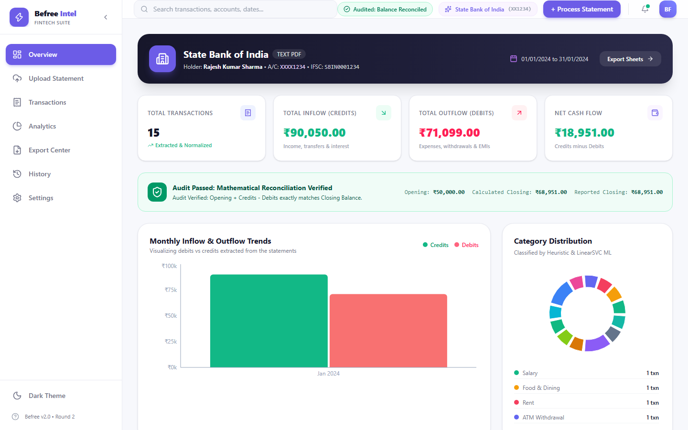
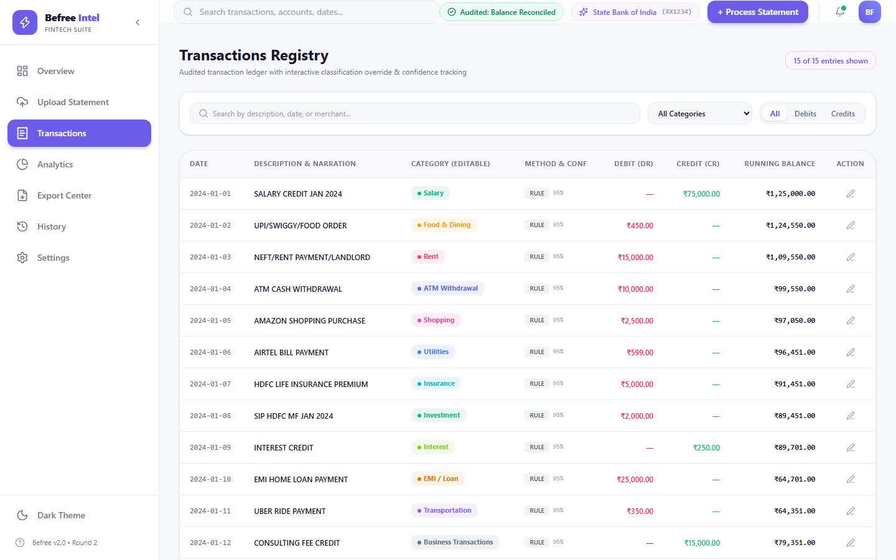
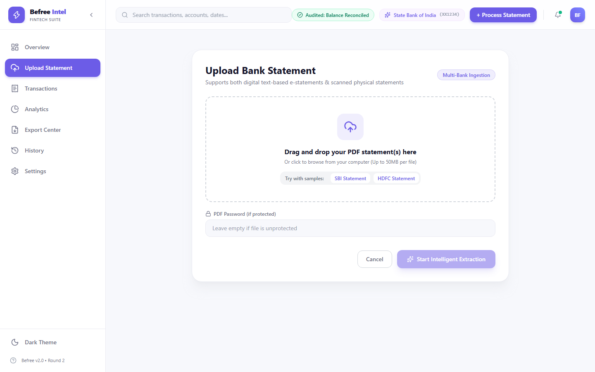
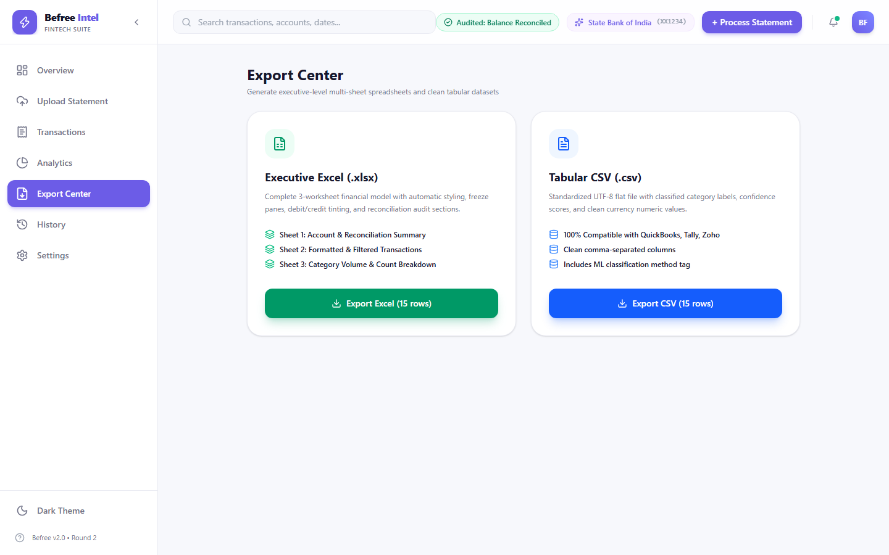

# 🏦 Befree Statement Intelligence
> **Next-Generation Bank Statement Processing & Classification System**  
> *Befree Automation Internship — Technical Assessment Round 2*

[](https://python.org)
[](https://fastapi.tiangolo.com)
[](https://react.dev)
[](https://tailwindcss.com)
[](https://scikit-learn.org)
[](https://pytest.org)

---

## 🌐 Live Public Demo
**Live Link:** [https://distribution-external-thereby-belly.trycloudflare.com](https://distribution-external-thereby-belly.trycloudflare.com)  
*(Interactive full-stack cloud instance running live without any warning or login required)*

---

## 📸 Interface Preview

### 1. Animated FinTech Landing Page


### 2. Executive Analytics Dashboard & Balance Audit


### 3. Interactive Transaction Registry & Manual Override


### 4. Statement Ingestion Hub & Animated Processing Timeline


### 5. Multi-Sheet Executive Excel & CSV Export Suite


---

## 💡 Executive Summary
**Befree Statement Intelligence** is a production-grade financial document processing suite built for the Befree Automation Internship Round 2. It accepts single or multi-page bank statements in PDF format (both digital text and scanned physical documents), automatically extracts account details, parses and cleans transaction tables, categorizes transactions across **17 categories without using any Large Language Models (LLMs)**, validates mathematical balance continuity, and exports structured results to multi-worksheet Excel workbooks and CSV files.

---

## 🚀 Key System Capabilities

### 1. Ingestion & Intelligent PDF Handling
- **Text & Scanned Ingestion**: Analyzes character bounding-box densities using PyMuPDF to identify text vs. scanned image PDFs automatically.
- **OCR Engine Fallback**: Integrates OpenCV image preprocessing (adaptive Otsu thresholding, fast non-local means denoising, deskewing) with Tesseract OCR.
- **Account Metadata Extraction**: Automatically detects and extracts Account Holder Name, Masked Account Number, IFSC Code, Bank Name, Statement Period, Opening Balance, and Closing Balance.
- **Multiline Row Stitching**: Intelligently handles description text wrapping across multiple lines and page breaks without corrupting debit/credit alignment.

### 2. Multi-Tier Non-LLM Classification Engine
Zero reliance on external generative AI or paid APIs. High throughput, deterministic, and privacy-preserving.
- **Tier 1 (Heuristic Rule Engine)**: Priority-ranked keyword dictionary (`config/classification_rules.json`) with strict regex word boundaries (`\b`) preventing false positives (e.g., prevents `"PREMIUM"` from falsely matching `"EMI"`).
- **Tier 2 (Traditional Machine Learning)**: Character n-gram TF-IDF vectorizer (2–4 n-grams) paired with a `LinearSVC` (Support Vector Classifier) trained on banking data.
- **Tier 3 (Confidence Scoring & Fallback)**: Assigns confidence scores; categorizes low-margin transactions as `Other / Uncategorized` for interactive human-in-the-loop review.

### 3. Mathematical Balance Reconciliation
Validates the financial equation:
$$\text{Opening Balance} + \sum \text{Credits} - \sum \text{Debits} \approx \text{Closing Balance}$$
Flags discrepancies with tolerance checks (₹1.00) and displays audit notifications directly in the interface.

### 4. Executive Multi-Sheet Export
- **Excel (`.xlsx`)**: 
  - **Sheet 1 (Account Summary)**: Account holder metadata and mathematical audit status.
  - **Sheet 2 (Transactions)**: Color-coded entries (soft coral for debits, mint teal for credits), freeze panes, and auto-filters.
  - **Sheet 3 (Category Summary)**: Aggregated category volume, counts, and expenditure percentages.
- **CSV (`.csv`)**: Standardized UTF-8 tabular export.

---

## 🏗️ System Architecture

```text
bank_statement_processor/
├── app.py                      # Original Streamlit Prototype
├── server.py                   # High-Performance FastAPI Backend Engine
├── Dockerfile                  # Container Deployment Specification
├── render.yaml                 # Render Cloud Deployment Manifest
├── requirements.txt            # Python Dependencies
│
├── frontend/                   # Redesigned React FinTech SaaS Frontend
│   ├── src/
│   │   ├── components/         # Landing, Overview, Upload, Ledger, Export, History
│   │   ├── App.tsx             # Main Application Shell & Theme Switcher
│   │   └── types.ts            # TypeScript Financial Data Interfaces
│   ├── package.json
│   └── vite.config.ts
│
├── modules/                    # Core Python Financial Engines
│   ├── pdf_detector.py         # Text-layer vs Image Scanner
│   ├── pdf_handler.py          # Password Decryption & File Validation
│   ├── text_extractor.py       # pdfplumber Parsing & Regex Account Identification
│   ├── ocr_engine.py           # OpenCV Preprocessing + Tesseract OCR
│   ├── transaction_parser.py   # Row Normalization & Continuation Stitching
│   ├── bank_parser.py          # Multi-Statement Extraction Coordinator
│   ├── rule_engine.py          # Heuristic Dictionary Matching
│   ├── ml_classifier.py        # TF-IDF + LinearSVC Model
│   ├── classification_engine.py# Hybrid 3-Layer Classification Pipeline
│   ├── data_validator.py       # Data Sanity & Duplicate Detection
│   ├── reconciliation.py       # Financial Mathematical Audit Engine
│   ├── export_handler.py       # OpenPyXL 3-Sheet Workbook Generator
│   └── database.py             # SQLite Persistence Engine
│
├── config/
│   ├── categories.json         # 17 Financial Categories & Hex Colors
│   └── classification_rules.json# Configurable Keyword Rules
│
├── docs/screenshots/           # High-Resolution Documentation Images
└── tests/                      # Pytest Automated Test Suite (62 Tests)
```

---

## 🧪 Automated Testing Suite
Run all 62 unit and integration tests:
```powershell
python -m pytest tests/ -v
```

```text
======================== 62 passed, 1 warning in 2.00s ========================
```
- `test_classification.py`: Verifies word-boundary rules, TF-IDF + LinearSVC predictions, and fallback scoring.
- `test_extraction.py`: Validates date parsing formats, amount normalizations, and multi-page table extraction.
- `test_validation.py`: Tests duplicate detection and sanity validation.
- `test_export.py`: Verifies valid `.xlsx` ZIP header bytes, multi-sheet structures, and CSV formatting.

---

## 🛠️ Local Installation & Setup

### Prerequisites
- Python 3.10+
- Node.js 18+ & npm

### 1. Clone & Set Up Python Backend
```powershell
git clone https://github.com/YOUR_USERNAME/befree-statement-intelligence.git
cd befree-statement-intelligence

# Install Python dependencies
pip install -r requirements.txt uvicorn fastapi python-multipart
```

### 2. Set Up React Frontend
```powershell
cd frontend
npm install
```

### 3. Launch with 1-Click
Simply run the included batch file:
```powershell
.\start_web.bat
```
Or start manually in two terminals:
- **Backend**: `python -m uvicorn server:app --port 8000 --host 0.0.0.0`
- **Frontend**: `cd frontend && npm run dev`

Visit **http://localhost:3000** in your browser.

---

## 👥 Author & Submission
- **Project**: Befree Statement Intelligence
- **Candidate**: Befree Automation Internship Candidate (Round 2)
- **Role Target**: Automation Engineer / Python Developer / Data Extraction Specialist
